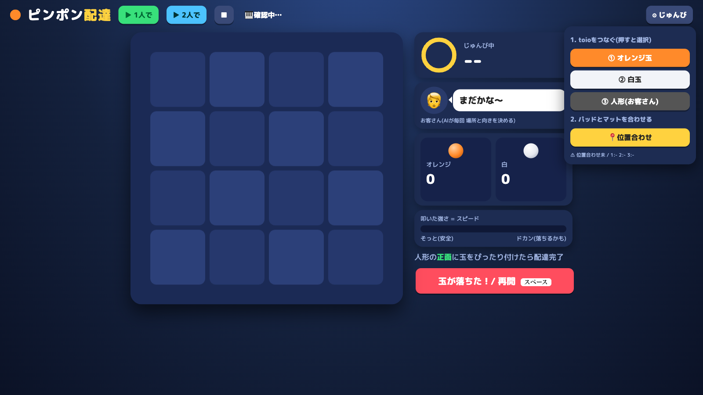

# ピンポン配達



toio の玉を、パッドを叩いた強さで飛ばして、お客さん(人形の toio)に届けるゲーム。
お客さんの場所と向きは毎回 AI が決める。
人形の正面に玉をぴったり付けたら配達完了。1人でも2人でも遊べる。
2026年10月4日のハッカソンで作成。

- 使うもの: toio 3台(オレンジ玉・白玉・人形)、MIDI パッド
- 叩いた強さ = スピード。そっとなら安全、ドカンだと落ちるかも

## 動かし方

```
pip install pyserial pygame
python3 bridge.py
```

H3 がつながっていなくても、画面だけで遊べる。
スティック等の確認: http://localhost:8891/devices
- ゲーム: http://localhost:8891/ (Chrome で開く。toio と MIDI パッドは Chrome 限定)
- AI を使うときは環境変数 `GEMINI_API_KEY` を設定する
